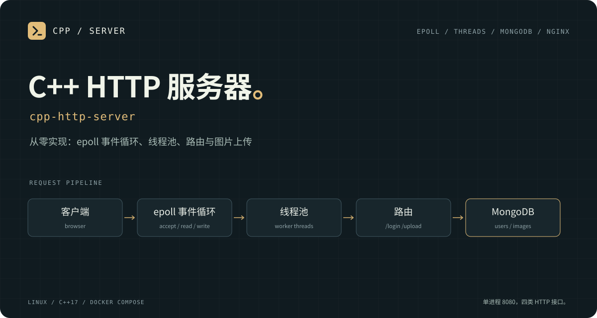

# C++ HTTP Server

[简体中文](README.md) · **English** · [Español](README.es.md) · [日本語](README.ja.md)

A Linux C++17 HTTP/1.1 server for account registration, login, logout, and private PNG uploads. An `epoll` event loop owns connections and incrementally parses requests. A bounded worker pool processes complete requests and returns responses through `eventfd`. Workers hold request values, not sockets; a connection ID prevents late responses from reaching a different client when a file descriptor is reused.

[Login](docs/validation/ui-login.png) · [Registration](docs/validation/ui-register.png) · [Mobile upload](docs/validation/ui-upload-mobile.png) · [Verification results](docs/optimization-validation.md)

## Build on Linux

The [Linux CI](.github/workflows/linux.yml) target is Ubuntu 22.04 with GCC 11 and CMake 3.22. The [dependency script](scripts/install-mongo-drivers.sh) pins MongoDB C driver 1.25.4 and C++ driver 3.9.0 with SHA-256 checks. From the repository root:

```sh
sudo apt-get update
sudo apt-get install -y g++ cmake ninja-build curl pkg-config libsodium-dev libpng-dev libssl-dev libsasl2-dev
bash scripts/install-mongo-drivers.sh "$PWD/.deps"
export PKG_CONFIG_PATH="$PWD/.deps/lib/pkgconfig"
export LD_LIBRARY_PATH="$PWD/.deps/lib"
cmake -S . -B build -G Ninja -DCMAKE_BUILD_TYPE=Debug
cmake --build build --parallel 2
ctest --test-dir build --output-on-failure
```

## Run locally

Start with a reachable MongoDB instance and a dedicated development database. This example uses loopback and plain HTTP:

```sh
export MONGODB_URI='mongodb://127.0.0.1:27017/?serverSelectionTimeoutMS=2000&connectTimeoutMS=2000&socketTimeoutMS=2000&maxPoolSize=8&waitQueueTimeoutMS=2000'
export MONGODB_DATABASE=cpp_http_dev
export SESSION_COOKIE_SECURE=0
export PUBLIC_ORIGIN=http://localhost:8080
./build/myserver 8080
```

Visit `http://localhost:8080/register`, then `/login` to reach `/upload`. `GET /` returns `Hello, World!`. For HTTPS access, keep `SESSION_COOKIE_SECURE=1` and set `PUBLIC_ORIGIN` to the browser-facing origin; TLS must terminate outside this server. Startup checks the database, unique username index, HTML pages, and storage. `APP_ROOT` defaults to the current directory, and `STORAGE_ROOT` to its `images` subdirectory.

## Routes and limits

| Route | Behavior |
| --- | --- |
| `GET /register`, `GET /login` | Registration and login forms. |
| `POST /register`, `POST /login` | URL-encoded `username` and `password`. Registration returns 201 or 409 for a duplicate; login sets a session cookie and redirects with 303. |
| `POST /logout` | Revokes the current session and clears its cookie. |
| `GET /upload`, `POST /upload` | Authenticated form and multipart upload. Use `file` and optionally `description`; success returns 201 with the image ID and URL. |
| `GET /images`, `GET /images/{id}` | Lists the current user's image metadata or reads one of that user's PNGs. |

- [Auth.h](Auth.h) checks sessions and same-origin writes. Cookies are `HttpOnly`, `SameSite=Strict`, and `Secure` by default. Sessions are process-local and expire on restart; deploy a single instance. [Database.h](Database.h) borrows clients from a `mongocxx::pool` and stores Argon2id password hashes. Legacy plaintext records require a separate migration or a fresh database.
- [ImageStorage.h](ImageStorage.h) isolates images by user. Defaults: 1 MiB, 4,194,304 pixels, 100 images per user. The file must be a valid PNG with a `.png` extension (case-insensitive). Names are limited to 120 ASCII bytes using letters, digits, `.`, `_`, or `-`, with no leading dot or `..`. Metadata and bytes are published together in one `.asset` via `renameat2(RENAME_NOREPLACE)`; a duplicate returns 409. MongoDB is not used for a second image copy.
- [HttpRequest.h](HttpRequest.h) handles GET and POST, one request per connection. Header limit: 16 KiB. POST needs a valid `Content-Length`. There is no keep-alive, pipelining, chunked transfer, WebSocket, or TLS termination. Full work queues return 503. A timeout or disconnect does not undo work already started; after an upload conflict, check the image list before retrying. See [Config.h](Config.h) for limits and defaults.

## Integration and benchmarks

With `MONGODB_URI` pointing to a dedicated test service, run:

```sh
python3 -m pip install pymongo==4.10.1
python3 tests/integration.py --binary build/myserver --output build/integration-report.json
```

The suite creates and removes its own `cpp_http_test_*` database and image directory. The database interruption test needs `TEST_MONGO_CONTAINER` set to a container dedicated to the suite. Without it, the suite marks that case skipped and exits nonzero. [Dockerfile](Dockerfile), [Compose](docker-compose.yml), and [Nginx](nginx.conf) configurations are provided; independent container and proxy deployments are still unverified.

See [benchmark method](bench/README.md) and [raw CI results](bench/results/ci-38707224777-bench.json). `GET /` measures complete TCP connection cycles without database or file I/O. At four workers, the median was 12,409 req/s at concurrency 64; at 128, saturation increased tail latency and produced 503 responses. Use the figures for comparisons within that run, not as capacity estimates for login or uploads.

No repository-wide license is declared.
