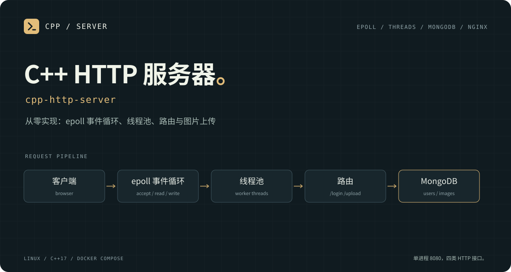

# Servidor HTTP en C++

[简体中文](README.md) · [English](README.en.md) · **Español** · [日本語](README.ja.md)

Servidor HTTP/1.1 en C++17 para Linux, con registro, inicio y cierre de sesión y gestión de imágenes PNG privadas. Un bucle `epoll` controla las conexiones y analiza las peticiones de forma incremental. Un grupo de hilos con cola acotada procesa las peticiones completas y entrega las respuestas mediante `eventfd`. Los hilos reciben los datos de la petición, sin acceso al socket; el identificador de conexión evita que una respuesta tardía llegue a otro cliente al reutilizar un descriptor.

[Inicio de sesión](docs/validation/ui-login.png) · [Registro](docs/validation/ui-register.png) · [Subida en móvil](docs/validation/ui-upload-mobile.png) · [Resultados de verificación](docs/optimization-validation.md)

## Compilación en Linux

La [integración continua](.github/workflows/linux.yml) usa Ubuntu 22.04, GCC 11 y CMake 3.22. El [script de dependencias](scripts/install-mongo-drivers.sh) fija los controladores MongoDB para C (1.25.4) y C++ (3.9.0) y comprueba sus sumas SHA-256. Desde la raíz del repositorio:

```sh
sudo apt-get update
sudo apt-get install -y g++ cmake ninja-build curl pkg-config libsodium-dev libpng-dev libssl-dev libsasl2-dev
bash scripts/install-mongo-drivers.sh "$PWD/.deps"
export PKG_CONFIG_PATH="$PWD/.deps/lib/pkgconfig"
export LD_LIBRARY_PATH="$PWD/.deps/lib"
cmake -S . -B build -G Ninja -DCMAKE_BUILD_TYPE=Debug
cmake --build build --parallel 2
ctest --test-dir build --output-on-failure
```

## Ejecución local

Usa una instancia de MongoDB accesible y una base dedicada al desarrollo. El ejemplo escucha en el equipo local y usa HTTP sin TLS:

```sh
export MONGODB_URI='mongodb://127.0.0.1:27017/?serverSelectionTimeoutMS=2000&connectTimeoutMS=2000&socketTimeoutMS=2000&maxPoolSize=8&waitQueueTimeoutMS=2000'
export MONGODB_DATABASE=cpp_http_dev
export SESSION_COOKIE_SECURE=0
export PUBLIC_ORIGIN=http://localhost:8080
./build/myserver 8080
```

Abre `http://localhost:8080/register` e inicia sesión en `/login` para llegar a `/upload`. `GET /` devuelve `Hello, World!`. Si el navegador accede por HTTPS, conserva `SESSION_COOKIE_SECURE=1` y asigna a `PUBLIC_ORIGIN` el origen visible para el navegador; el TLS debe terminar fuera del servidor. Al arrancar se comprueban la base, el índice de nombres únicos, las páginas y el almacenamiento. `APP_ROOT` toma el directorio actual y `STORAGE_ROOT` su subdirectorio `images` por defecto.

## Rutas y límites

| Ruta | Comportamiento |
| --- | --- |
| `GET /register`, `GET /login` | Formularios de registro y acceso. |
| `POST /register`, `POST /login` | Campos `username` y `password` codificados como formulario. El registro devuelve 201 o 409 si el usuario ya existe; el acceso establece una cookie y redirige con 303. |
| `POST /logout` | Revoca la sesión actual y borra su cookie. |
| `GET /upload`, `POST /upload` | Formulario y subida multipart con sesión. Envía `file` y opcionalmente `description`; el éxito devuelve 201 con el ID y la URL. |
| `GET /images`, `GET /images/{id}` | Muestra los metadatos o lee un PNG del usuario autenticado. |

- [Auth.h](Auth.h) comprueba sesiones y escrituras desde el mismo origen. Las cookies usan `HttpOnly`, `SameSite=Strict` y, por defecto, `Secure`. Las sesiones viven en el proceso, se pierden al reiniciar y están pensadas para una sola instancia. [Database.h](Database.h) usa `mongocxx::pool` y almacena hashes Argon2id. Las contraseñas antiguas en texto plano requieren una migración separada o una base nueva.
- [ImageStorage.h](ImageStorage.h) separa las imágenes por usuario. Límites iniciales: 1 MiB, 4.194.304 píxeles y 100 imágenes por usuario. El archivo debe ser un PNG válido con extensión `.png`, sin distinguir mayúsculas. El nombre admite hasta 120 bytes ASCII con letras, dígitos, `.`, `_` o `-`; no puede empezar con punto ni contener `..`. Los metadatos y bytes se publican juntos en un `.asset` con `renameat2(RENAME_NOREPLACE)`; un duplicado devuelve 409. No se guarda una segunda copia de la imagen en MongoDB.
- [HttpRequest.h](HttpRequest.h) admite GET y POST, una petición por conexión. Las cabeceras tienen un límite de 16 KiB y POST necesita un `Content-Length` válido. No hay keep-alive, pipelining, transferencia chunked, WebSocket ni terminación TLS. Una cola de trabajo llena devuelve 503. Un corte o timeout no deshace el trabajo ya iniciado; tras un conflicto de subida, consulta la lista antes de reintentar. Los valores configurables están en [Config.h](Config.h).

## Integración y rendimiento

Configura `MONGODB_URI` para un servicio de pruebas dedicado y ejecuta:

```sh
python3 -m pip install pymongo==4.10.1
python3 tests/integration.py --binary build/myserver --output build/integration-report.json
```

Las pruebas crean y eliminan su propia base `cpp_http_test_*` y su directorio de imágenes. La prueba de interrupción de MongoDB necesita que `TEST_MONGO_CONTAINER` apunte a un contenedor dedicado. Sin él, el caso queda omitido y la ejecución termina con código distinto de cero. El repositorio incluye [Dockerfile](Dockerfile), [Compose](docker-compose.yml) y [Nginx](nginx.conf), pero el despliegue independiente del contenedor y del proxy aún no se ha verificado.

Consulta el [método de medición](bench/README.md) y los [resultados originales de CI](bench/results/ci-38707224777-bench.json). `GET /` mide ciclos completos de conexión TCP sin acceso a base ni archivos. Con cuatro hilos de trabajo, la mediana fue de 12.409 peticiones/s con concurrencia 64; a 128 aumentó la latencia del percentil 99 y hubo respuestas 503. Las cifras sirven para comparar configuraciones en esa ejecución, no para estimar la capacidad de inicio de sesión o de subida.

No se declara una licencia para el repositorio en su conjunto.
