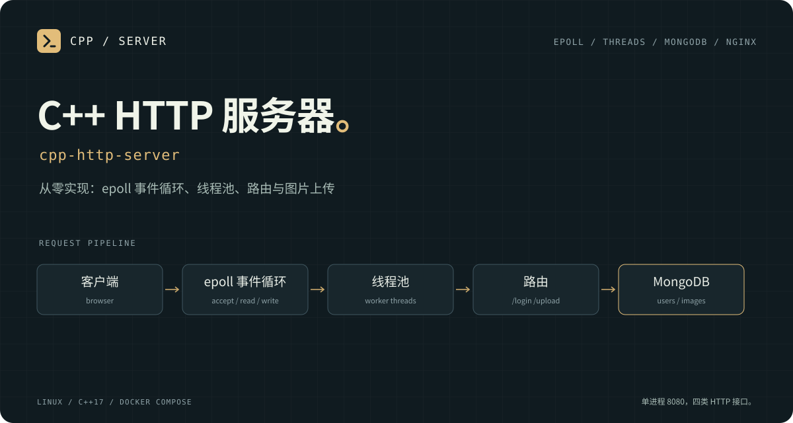

# C++ HTTP サーバー

[简体中文](README.md) · [English](README.en.md) · [Español](README.es.md) · **日本語**

登録、ログイン、ログアウト、ユーザーごとの PNG 管理を提供する Linux 向け C++17 の HTTP/1.1 サーバーです。`epoll` のイベントループが接続を管理し、リクエストを受信しながら解析します。完全なリクエストだけを容量制限付きのワーカープールに渡し、`eventfd` で応答を受け取ります。ワーカーはソケットを保持せず、接続 ID を使ってファイルディスクリプターの再利用による別クライアントへの誤送信を防ぎます。

[ログイン](docs/validation/ui-login.png) · [登録](docs/validation/ui-register.png) · [モバイルでのアップロード](docs/validation/ui-upload-mobile.png) · [検証結果](docs/optimization-validation.md)

## Linux でのビルド

[Linux CI](.github/workflows/linux.yml) は Ubuntu 22.04、GCC 11、CMake 3.22 を使用します。[依存関係の導入スクリプト](scripts/install-mongo-drivers.sh) は MongoDB C ドライバー 1.25.4 と C++ ドライバー 3.9.0 を固定し、SHA-256 を確認します。リポジトリのルートで実行します。

```sh
sudo apt-get update
sudo apt-get install -y g++ cmake ninja-build curl pkg-config libsodium-dev libpng-dev libssl-dev libsasl2-dev
bash scripts/install-mongo-drivers.sh "$PWD/.deps"
export PKG_CONFIG_PATH="$PWD/.deps/lib/pkgconfig"
export LD_LIBRARY_PATH="$PWD/.deps/lib"
cmake -S . -B build -G Ninja -DCMAKE_BUILD_TYPE=Debug
cmake --build build --parallel 2
ctest --test-dir build --output-on-failure
```

## ローカルでの起動

接続可能な MongoDB と開発専用のデータベースを用意します。次の例はループバック上の HTTP 用です。

```sh
export MONGODB_URI='mongodb://127.0.0.1:27017/?serverSelectionTimeoutMS=2000&connectTimeoutMS=2000&socketTimeoutMS=2000&maxPoolSize=8&waitQueueTimeoutMS=2000'
export MONGODB_DATABASE=cpp_http_dev
export SESSION_COOKIE_SECURE=0
export PUBLIC_ORIGIN=http://localhost:8080
./build/myserver 8080
```

`http://localhost:8080/register` で登録し、`/login` からログインすると `/upload` に移動します。`GET /` は `Hello, World!` を返します。HTTPS で利用する場合は `SESSION_COOKIE_SECURE=1` を維持し、`PUBLIC_ORIGIN` にブラウザーから見えるオリジンを設定してください。TLS は外部で終端します。起動時には DB、ユーザー名の一意インデックス、HTML ページ、保存先を検査します。`APP_ROOT` の既定値はカレントディレクトリ、`STORAGE_ROOT` の既定値はその `images` サブディレクトリです。

## エンドポイントと制約

| ルート | 動作 |
| --- | --- |
| `GET /register`、`GET /login` | 登録フォームとログインフォーム。 |
| `POST /register`、`POST /login` | URL エンコードされた `username` と `password` を受け付けます。登録は成功時 201、重複時 409。ログインは Cookie を設定して 303 でリダイレクトします。 |
| `POST /logout` | 現在のセッションを無効にし、Cookie を削除します。 |
| `GET /upload`、`POST /upload` | 認証済みユーザー向けフォームと multipart アップロード。`file` と任意の `description` を受け付け、成功時は ID と URL を含む 201 を返します。 |
| `GET /images`、`GET /images/{id}` | 認証済みユーザー自身の画像メタデータ一覧、または PNG 本体を返します。 |

- [Auth.h](Auth.h) がセッションと書き込み時の同一オリジンを確認します。Cookie は `HttpOnly`、`SameSite=Strict`、既定で `Secure` です。セッションは単一プロセス内に保持され、再起動で失われます。単一インスタンス向けです。[Database.h](Database.h) は `mongocxx::pool` を使い、パスワードの Argon2id ハッシュを保存します。旧平文レコードがある場合は別途移行するか、新規 DB を使用してください。
- [ImageStorage.h](ImageStorage.h) の保存先はユーザーごとに分離されます。既定の上限は 1 MiB、4,194,304 ピクセル、ユーザーあたり 100 枚です。有効な PNG のみを受け付け、拡張子は大文字・小文字を問わず `.png` です。ファイル名は半角英数字と `.`、`_`、`-` の最大 120 バイトで、先頭の `.` や途中の `..` は使用できません。メタデータと本体は一つの `.asset` に保存し、`renameat2(RENAME_NOREPLACE)` で公開します。同名は 409 を返し、MongoDB への二重保存は行いません。
- [HttpRequest.h](HttpRequest.h) が GET と POST を処理し、1 接続につき 1 リクエストで切断します。ヘッダーの上限は 16 KiB で、POST には有効な `Content-Length` が必要です。keep-alive、パイプライン、チャンク転送、WebSocket、TLS 終端には対応しません。キューが満杯なら 503 を返します。タイムアウトや切断では開始済みの処理を取り消せないため、再アップロード時に同名エラーが出たら一覧を確認してください。設定の詳細は [Config.h](Config.h) にあります。

## 結合テストと性能測定

`MONGODB_URI` にテスト専用サービスを設定し、次を実行します。

```sh
python3 -m pip install pymongo==4.10.1
python3 tests/integration.py --binary build/myserver --output build/integration-report.json
```

テストは専用の `cpp_http_test_*` DB と画像ディレクトリを作成・削除します。DB 停止テストには、テストだけで使うコンテナーを `TEST_MONGO_CONTAINER` に指定します。未指定の場合は該当ケースをスキップし、終了コードは非ゼロになります。[Dockerfile](Dockerfile)、[Compose](docker-compose.yml)、[Nginx](nginx.conf) の設定はありますが、コンテナーやプロキシを使った独立のデプロイ検証は未実施です。

[測定方法](bench/README.md) と [CI の生データ](bench/results/ci-38707224777-bench.json) を参照してください。`GET /` は DB やファイルに触れず、TCP の接続から切断までを測ります。ワーカー 4、同時実行数 64 では中央値が毎秒 12,409 リクエストでした。128 ではテールレイテンシーが伸び、503 が発生しました。数値は同じ測定内での比較に使い、ログインやアップロードの処理能力には当てはめないでください。

リポジトリ全体に適用されるライセンスは明記されていません。
