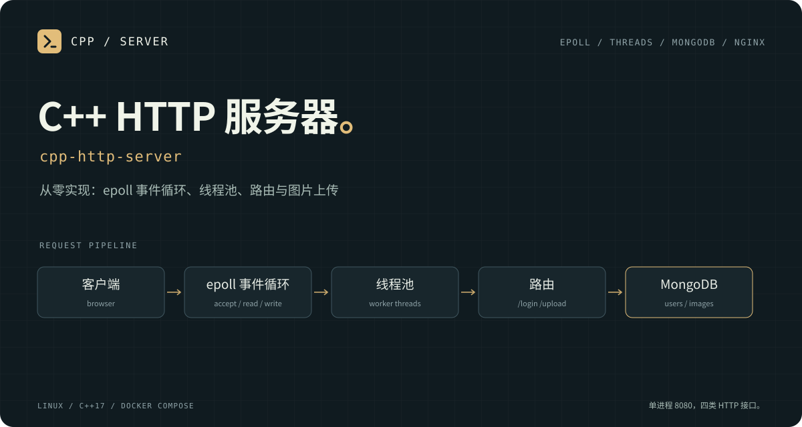

# C++ HTTP 服务器

Linux C++17 HTTP 服务：epoll 负责连接和收发，有界线程池处理完整请求，MongoDB 保存 Argon2id 密码哈希，图片通过单个存储模块校验并原子发布。

支持注册、登录、退出和个人 PNG 图片上传、列表、读取。协议范围为 HTTP/1.1 的 GET、POST，每个连接处理一个请求后关闭。

## 结构

```text
客户端 → epoll 线程：增量解析 → 完整请求 + 连接代号 → 有界工作队列
                                                   ↓
                                       Router → Auth / ImageStorage
                                                   ↓
epoll 线程：发送并关闭 ← eventfd 完成队列 ← 响应 + 连接代号
```

工作线程持有请求值，不持有套接字。连接代号递增，任务完成时按代号查找仍存活的连接；文件描述符被复用不会把旧响应发给新客户端。MongoDB 操作各自从 `mongocxx::pool` 借用客户端，返回后自动归还。

| 入口 | 作用 |
| --- | --- |
| [HttpRequest.h](HttpRequest.h) | 唯一的增量读取状态机，处理请求行、请求头、声明长度、正文、完成与失败 |
| [HttpServer.h](HttpServer.h) / [ThreadPool.h](ThreadPool.h) | 连接所有权、一次性事件注册、有限排队、响应回传、超时与退出回收 |
| [Router.h](Router.h) / [Auth.h](Auth.h) | 统一会话访问控制、注册、登录、退出和同源写入检查 |
| [Database.h](Database.h) | MongoDB 客户端池、用户名唯一索引、密码哈希记录 |
| [Multipart.h](Multipart.h) / [ImageStorage.h](ImageStorage.h) | multipart、PNG 解码校验、用户隔离、同名拒绝和单文件原子发布 |
| [Config.h](Config.h) / [main.cpp](main.cpp) | 显式配置、启动检查、退出信号处理 |

## 接口

| 方法 | 路径 | 行为 |
| --- | --- | --- |
| GET | `/` | 返回 `Hello, World!` |
| GET | `/login`、`/register` | 登录与注册页面 |
| POST | `/register` | `username`、`password` URL 编码表单；成功 201，重复用户名 409 |
| POST | `/login` | 校验密码，设置会话 Cookie，303 跳转 `/upload` |
| POST | `/logout` | 注销当前会话并清除 Cookie |
| GET | `/upload` | 登录后的上传页面 |
| POST | `/upload` | 登录后提交 `file` 和可选 `description` multipart；成功 201，返回图片标识及读取 URL |
| GET | `/images` | 当前用户的图片元信息 JSON 列表 |
| GET | `/images/{id}` | 读取当前用户对应的 PNG 原始字节 |

上传、图片访问和退出统一检查会话，未登录返回 401。会话只在当前进程内有效，重启后需要重新登录；本实现面向单实例。Cookie 默认具有 `HttpOnly`、`SameSite=Strict` 和 `Secure`。

图片原名只用于生成稳定标识，不参与路径拼接。默认接受不超过 1 MiB、4,194,304 像素的 PNG；文件名为 1 至 120 字节的英文字母、数字、点、下划线、连字符，不能包含 `..` 或以点开头。元信息和图片字节保存在同一个 `.asset` 记录中，发布使用 `renameat2(RENAME_NOREPLACE)`，同名返回 409。图片不再同时写入 MongoDB，避免两套存储的提交结果不一致。

## Linux 构建与验证入口

目标环境是 Ubuntu 22.04、GCC 11、CMake 3.22，MongoDB C 驱动 1.25.4、C++ 驱动 3.9.0，libsodium ≥ 1.0.18、libpng。驱动下载版本及 SHA-256 固定在 [安装脚本](scripts/install-mongo-drivers.sh) 中。

以下命令与 [Linux CI](.github/workflows/linux.yml) 共用构建入口。运行结果和仍待完成的验收见 [验证记录](docs/optimization-validation.md)。

```sh
sudo apt-get update
sudo apt-get install -y g++ cmake ninja-build curl pkg-config libsodium-dev libpng-dev libssl-dev libsasl2-dev
bash scripts/install-mongo-drivers.sh "$PWD/.deps"
export PKG_CONFIG_PATH="$PWD/.deps/lib/pkgconfig"
export LD_LIBRARY_PATH="$PWD/.deps/lib"
cmake -S . -B build -G Ninja -DCMAKE_BUILD_TYPE=Debug
cmake --build build --parallel 2
ctest --test-dir build --output-on-failure
```

使用独立的测试数据库启动，MongoDB 必须已经可访问：

```sh
export MONGODB_URI='mongodb://127.0.0.1:27017/?serverSelectionTimeoutMS=2000&connectTimeoutMS=2000&socketTimeoutMS=2000&maxPoolSize=8&waitQueueTimeoutMS=2000'
export MONGODB_DATABASE=cpp_http_dev
export SESSION_COOKIE_SECURE=0
export PUBLIC_ORIGIN=http://localhost:8080
./build/myserver 8080
```

`SESSION_COOKIE_SECURE=0` 用于上述本机 HTTP 环境；HTTPS 部署保留默认值 `1`，并把 `PUBLIC_ORIGIN` 设置为实际浏览器访问的 origin。进程启动前会检查数据库、唯一索引、页面文件和存储目录，失败以非零退出码和明确日志终止。

自动化验证命令：

```sh
python3 tests/reproduce_legacy.py
python3 tests/run_portable.py
python3 -m pip install pymongo==4.10.1
python3 tests/integration.py --binary build/myserver --output build/integration-report.json
```

集成脚本实际创建并删除唯一的 `cpp_http_test_*` 数据库及本轮临时图片目录。完整停库验收还需设置 `TEST_MONGO_CONTAINER`，且该容器必须只服务于本次测试；CI 已提供该隔离容器。没有容器时，脚本把停库测试列为未执行，并以非零结果结束，不能把部分通过当作完整验收。

## 配置与协议边界

| 环境变量 | 默认值或要求 |
| --- | --- |
| `MONGODB_URI`、`MONGODB_DATABASE` | 必填；数据库名仅字母、数字、下划线 |
| `PORT`、`BIND_ADDRESS` | `8080`、`127.0.0.1`；命令行端口覆盖 `PORT` |
| `APP_ROOT`、`STORAGE_ROOT` | 当前目录、`APP_ROOT/images` |
| `WORKER_THREADS`、`TASK_QUEUE_CAPACITY`、`MAX_CONNECTIONS` | `4`、`64`、`512`；满队列返回 503 |
| `MAX_UPLOAD_BYTES`、`MAX_IMAGE_PIXELS`、`MAX_IMAGES_PER_USER` | `1048576`、`4194304`、`100` |
| `MAX_SESSIONS`、`SESSION_TTL_SECONDS` | `1024`、`1800` |
| `READ_TIMEOUT_MS`、`PROCESSING_TIMEOUT_MS`、`WRITE_TIMEOUT_MS` | `5000`、`30000`、`5000`；收发使用无进展超时 |
| `SESSION_COOKIE_SECURE`、`PUBLIC_ORIGIN` | `1`、`http://localhost:{PORT}` |

- 请求头最多 16 KiB；正文上限为上传上限加 16 KiB multipart 开销。POST 必须声明有效的 `Content-Length`。
- 分段正文未到齐不会进入路由。错误长度、重复头、越界正文返回明确 4xx；`Transfer-Encoding` 返回 501，`Expect` 返回 417。
- 不支持 keep-alive、流水线、chunked、WebSocket 或 TLS 终止。所有响应带 `Content-Length` 和 `Connection: close`。
- 超时或客户端断连不能撤销已经开始的业务操作。上传重试遇到同名 409 时，可通过图片列表确认此前是否已经完整发布；不会暴露 `.part` 文件。
- 旧明文用户记录会使启动明确失败，需要先完成单独迁移或选择新数据库；旧图片原件和 MongoDB 图片记录不会自动删除或改写。

## 容器与验证范围

[Dockerfile](Dockerfile) 使用同一 CMake 和固定依赖脚本构建，应用以非 root 用户运行。[Compose 配置](docker-compose.yml) 提供 MongoDB 健康检查、持久卷、必填口令和仅本机端口映射；用户名及口令需使用 URI 未保留字符，建议口令为随机十六进制字符串。[Nginx 配置](nginx.conf) 只指向一个应用实例，不缓存登录、注册或上传。

容器部署与 Nginx 代理尚待独立实跑，暂不列为已验证的快速开始。CI 的真实 MongoDB 服务用于直接构建的应用验收，不等同于验证 Compose 部署。

当前测量只用作固定环境下的基线。性能数据必须同时附环境、请求数、并发数、错误数、延迟和资源回收记录，不据单元测试数量推断吞吐能力。
