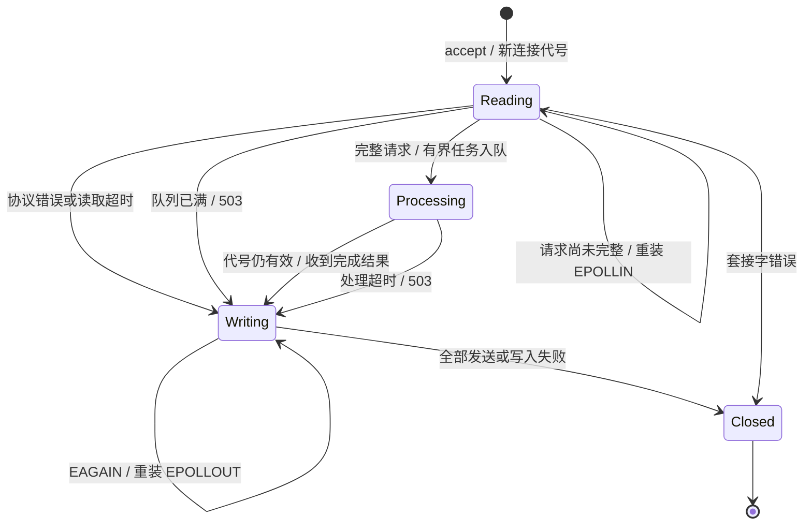

# CP-01 至 CP-04 验证记录

更新日期：2026-10-15。目标是项目优化清单的完整验收，状态必须以实际运行证据为准。

## 当前结论

| 项目 | 已实现内容 | 完整验收状态 |
| --- | --- | --- |
| CP-01 | CMake、固定版本及 SHA-256 驱动安装、必填数据库配置、启动检查、Linux CI、容器配置整理 | Linux 驱动安装通过；应用头文件依赖修正后等待重跑；真实启动尚未验收 |
| CP-02 | 一个增量状态机；独立 HTTP 字节序列测试；拒绝重复头、错误长度、超限与不支持传输 | 本地 5,172 项协议检查通过；等待真实 Linux HTTP 验收 |
| CP-03 | epoll 独占连接；工作线程只持有请求和代号；有界队列；MongoDB 客户端池；超时与回收指标 | 等待线程池、并发、ASan/UBSan、TSan 真实回执及基线数字 |
| CP-04 | Argon2id、会话与退出、统一访问控制、PNG 校验、个人隔离、原子单文件存储 | 等待真实注册/登录/退出、数据库记录、上传与读取验收 |

以上“已实现”不代表完整通过。未拿到的 Linux、数据库、资源回收与 Sanitizer 结果不填写成功。

## 已取得的证据

### 历史问题复现

命令：`D:\Anaconda\python.exe tests\reproduce_legacy.py`。

- 历史版本：`afa204633aa1c7df12128786e663042a9e7be37e`。
- 本机编译器：MinGW GCC 6.3.0。
- 声明正文 26 字节，实际只交给旧解析器 13 字节，真实运行输出 `premature_accept`。
- 脚本从 Git 的固定历史版本取出头文件，经实际 C++ 编译后执行；临时编译目录由本次脚本创建并在退出时清理。

### 当前协议状态机

命令：`D:\Anaconda\python.exe tests\run_portable.py`。

结果：`PASS parser checks=5172`，退出码 0。

覆盖每一个两段切分位置、逐字节到达、16,000 字节正文、6,000 字节请求头、大小写与重复请求头、错误/溢出长度、半关闭、流水线字节、multipart 二进制保持、5,000 组固定种子的随机字节序列，以及响应长度。此检查没有替代真实 Linux 网络服务。

Python 集成脚本通过 AST 语法检查；`git diff --check` 通过。没有在本机安装 Docker、WSL 或 MongoDB，也没有更改系统配置。

### 驱动下载核验与首轮失败

- 首轮提交 `a251ff9f374ce7b957c3cba442b93edab48b4880` 的 [CI 38672072936](https://github.com/Hokkaidoooo/cpp-http-server/actions/runs/38672072936) 中，两个 Sanitizer job 都在“编译 MongoDB 驱动”步骤失败，尚未运行应用构建和集成测试。
- GitHub API 实查 Mongo C driver 1.25.4 的 release 资产为空，原 release 下载地址不可用。安装脚本已改为官方固定标签 archive，并显式传入 `BUILD_VERSION=1.25.4`。
- 修正后的 C archive 已取得 HTTP 200，7,308,431 字节；Python 标准 `tarfile` 实际解析 3,477 项，根目录为 `mongo-c-driver-1.25.4`，读取到 23,323 字节的 `CMakeLists.txt`。
- C++ driver r3.9.0 的官方 release tarball 实际返回 HTTP 200，1,904,030 字节。两份下载都按实际取得内容固定 SHA-256，并在安装脚本中强制核验。
- C SHA-256：`0ab3c5b238803b82a6b217d1ef21ea71a6e96251063322dc1038bea70a3da541`。
- C++ SHA-256：`a5f0844ad6eb52747300a3905e35101b756edbce33629cf8b4baa1d36b426f98`。

第二轮提交 `5c5c60e` 的 [CI 38673486432](https://github.com/Hokkaidoooo/cpp-http-server/actions/runs/38673486432) 已完成驱动编译安装和版本识别，进入真实 C++ 构建。在 `Database.h` 的三个客户端索引表达式处报 `no match for operator[]`：`pool.hpp` 只提供客户端前向声明，使用端缺少 `client.hpp`、`database.hpp`、`collection.hpp` 的完整类型声明。修正为直接包含所依赖的三个接口头文件，等待第三轮重跑。

已实际下载第二轮 address job 的 333,879 字节完整日志并定位上述编译错误。Actions 日志下载曾遭 TLS 握手超时；改用 HTTPS API 获取重定向、再不带 GitHub 凭据读取签名日志，未修改代理配置。首轮原始 curl 日志仍未取得，不作引用。

## 连接与任务所有权

不变量：

1. 只有 epoll 线程访问连接表、读取、发送、修改事件和关闭 fd。
2. `EPOLLONESHOT` 在请求进入工作队列后保持停用；一个连接只派发一次完整请求。
3. 工作线程只收到请求值和单调递增的 64 位连接代号，不收到 fd 或连接对象引用。
4. 超时/关闭后返回的结果找不到有效 Processing 代号时丢弃，并增加 `stale_completions`；不会按旧 fd 查找连接。
5. 队列满返回 503；关闭时先停止接收并等待有限任务完成，再关闭连接、输出回收指标。线程池异常不隐藏在未读取的 future 中。
6. MongoDB 池中借出的客户端只供当前一次操作使用，不跨线程共享 `client` 或 `collection`。

## 图片与认证规则

`Auth` 是唯一会话入口。用户名采用唯一索引；新记录只保存 `password_hash`。Argon2id 使用 libsodium 的 interactive 参数，盐由库产生；登录 Cookie 使用 256 位随机标识，过期与容量均有显式配置。保护路径只在 `Router::routeRequest` 统一判断。

`ImageStorage` 是唯一图片真源；MongoDB 原 `images` 集合不再接收新记录。每条 `.asset` 文件包含版本标记、原名、说明和 PNG 字节。目录按用户名的 BLAKE2b 标识隔离，文件按原名标识定位，读取只在当前登录用户目录中进行。

记录格式：8 字节 `CPIMG001`，接着是三个 8 字节大端长度（原名、说明、PNG），最后依次为这三段内容。读取时验证格式、长度、普通文件类型和原名标识，不用空值掩盖损坏。

原名不参与路径拼接，目录及文件以 `openat`、`O_NOFOLLOW` 操作。写入临时文件使用 `O_EXCL`，完整写入并同步后以 `renameat2(RENAME_NOREPLACE)` 发布。原名重复返回 409，普通错误路径清除本次 `.part`，读取接口不会暴露未完成内容。PNG 必须通过文件头、数据块边界、IEND、尺寸上限和 libpng 实际解码检查，拒绝尾随脚本内容。

业务操作已经开始后，HTTP 超时或断连不能承诺回滚。进程强制终止或磁盘清理本身失败可能留下私有 `.part`；它不会被列表或读取接口发布，清理失败有明确日志。没有自动删除未知磁盘文件的恢复任务。

## Linux 验收入口与证据保存

完整入口是 `.github/workflows/linux.yml`，目标 Ubuntu 22.04、GCC 11、MongoDB 7.0.16、C/C++ 驱动 1.25.4/3.9.0。每次 CI 记录实际内核、编译器、CMake 和库版本。

| 阶段 | 命令/入口 | 通过标准 |
| --- | --- | --- |
| 依赖 | `bash scripts/install-mongo-drivers.sh "$PWD/.deps"` | 下载校验、C/C++ 驱动编译安装、pkg-config 版本输出均成功 |
| 警告与构建 | `cmake -S . -B build -G Ninja -DCMAKE_BUILD_TYPE=Debug -DSANITIZER=address`，`cmake --build build --parallel 2` | `-Wall -Wextra -Wpedantic -Werror` 无错误 |
| 定向测试 | `ctest --test-dir build --output-on-failure` | parser 与 thread_pool 都运行并通过 |
| HTTP / MongoDB | `python3 tests/integration.py --binary build/myserver --output build/integration-report.json` | 13 组真实测试全部通过，停库测试未跳过 |
| 内存与 UB | `SANITIZER=address`、ASAN/UBSAN halt-on-error | 实际 HTTP 测试完成，退出码 0，无 Sanitizer 报告 |
| 数据竞争 | `SANITIZER=thread`、TSAN halt-on-error | 同一套真实请求完成，退出码 0，无竞争报告 |

TSan job 在一次性 Linux runner 中把 `vm.mmap_rnd_bits` 设为 28，以提供其所需的影子内存地址空间；没有修改本机 Windows 配置，也没有屏蔽 Sanitizer 诊断。TSan 若仍不能运行，必须保留失败，不能换成“未发现竞态”。

集成脚本包含：根路径与页面、分段正文不提前响应且注册一次、分段大请求头、协议错误、错误配置及不可用数据库、真实登录和退出、来源与会话拒绝、PNG 原字节读回、用户间隔离、路径攻击、同名并发、非法内容、超限、240 次/12 并发基线、100 轮断连与 fd 复用、96 并发注册触发队列满、读取超时、运行中停库后的真实 500。

报告保存：`build/integration-report.json`、`build/server.log`、`build/Testing/Temporary/LastTest.log`。CI 分别上传 `validation-address`、`validation-thread`。基线报告含请求数、并发数、错误数、平均/P50/P95/P99 延迟、运行前后 fd/线程/RSS、退出时 accepted/closed/active。

目前尚无已通过的 Linux 基线，不填写推测数字，不宣称相较旧版提升了性能。

## 保护与清理

- 旧 `images/` 原件、历史 MongoDB 记录、`assets/cover.svg` 保留；新存储协议不自动迁移或覆盖旧文件。
- 不再使用的 `Logger.h`、`mongo.sh`、`mongo1.sh` 已移除，构建安装只保留一份驱动脚本；这些是实现调整，并非临时目录清理。
- 本地复现与协议测试的临时编译目录已由各脚本退出清理；依赖下载核验只在内存解析，没有留下安装包。
- 集成测试只清理自身新建的随机测试数据库和临时图片目录；失败会写入 `cleanup_errors` 并导致非零退出。报告与日志作为验收证据保留。
- Docker、Compose、Nginx 的独立部署尚未实跑，不能据 Linux 应用 CI 的结果把这些部署方式写为通过。
